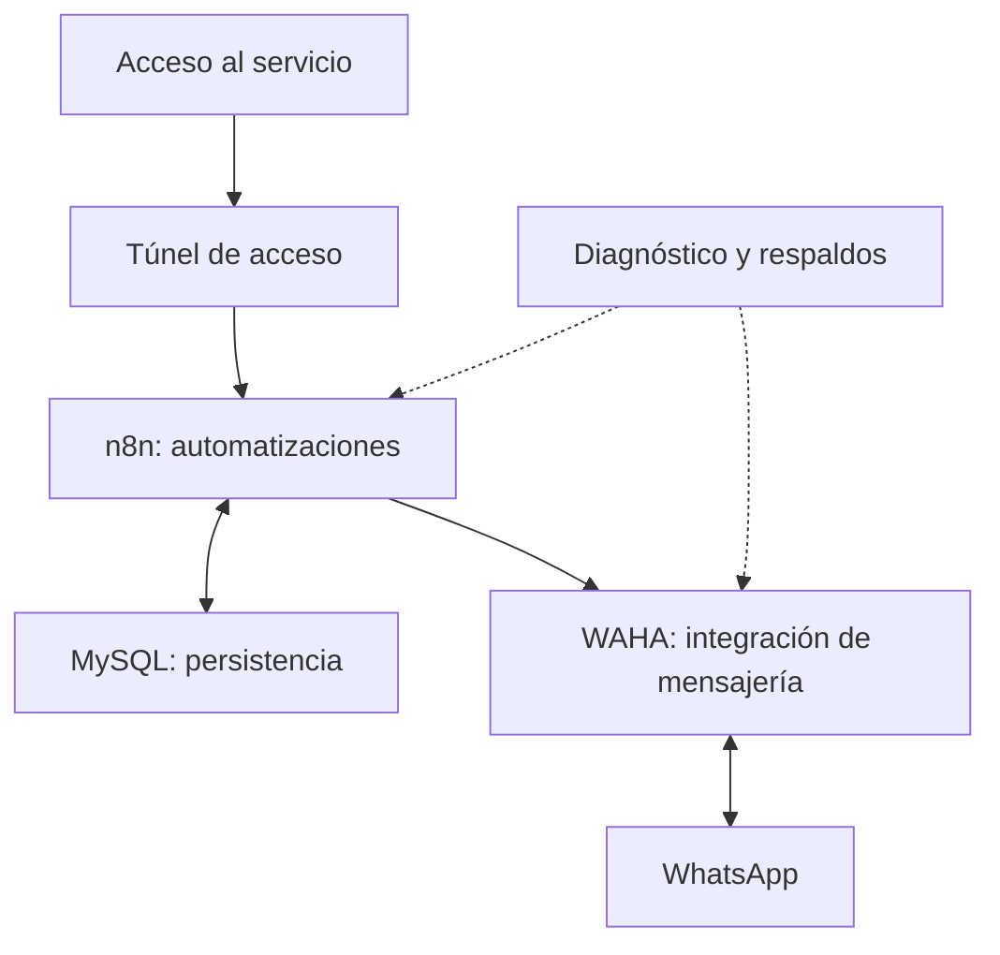

# Consultorio digital · Automatización de turnos

**Caso técnico de integración, despliegue y operación de recordatorios y confirmaciones por WhatsApp.**

Proyecto propio de Lisandro Mansilla · Ingeniería en Computación en curso  
Docker / Compose · n8n · MySQL · WAHA · WhatsApp

## El proyecto

Integración de servicios en un VPS para apoyar la gestión de turnos mediante automatizaciones y mensajería. n8n coordina los flujos, MySQL participa en la persistencia y WAHA conecta con WhatsApp.

El trabajo documentado incluye configuración de contenedores y volúmenes, diagnóstico de recursos, comprobaciones de salud, validación de un respaldo y recuperación de la sesión de mensajería. La disponibilidad y el rendimiento actuales no fueron auditados desde este repositorio.

**Alcance de este repositorio:** presentación del caso y herramientas de medición con datos agregados. Las capturas originales de operación contienen información privada y se conservan fuera del repositorio.

## Arquitectura y decisiones



La separación de servicios y volúmenes permite revisar el estado de cada componente. La salud de n8n, el estado de la sesión de WhatsApp y la entrega de un recordatorio son comprobaciones diferentes.

## Medición reproducible

El repositorio incluye un calculador de recursos y contadores agregados. Los archivos distribuidos son plantillas vacías: la publicación de un dataset operativo requiere revisar su fuente, período y alcance de divulgación.

Las pruebas del calculador usan fixtures identificados como sintéticos. Ninguno de sus valores representa pacientes, entregas o rendimiento real del Consultorio.

Los rangos de recursos incluyen una sección `trazabilidad_metricas` con unidad, mínimo, máximo, cantidad de muestras, fecha y fuente. Se mantienen los campos escalares anteriores para consumidores existentes.

## Indicadores de operación

| Indicador | Estado |
|---|---|
| Recordatorios únicos intentados y entregados | Pendiente de una exportación agregada con estados de entrega confirmados. |
| Tasa de entrega | Pendiente de numerador y denominador de la misma cohorte. |
| Asistencias y ausencias | Pendiente de resultados de turnos confirmados. |
| Reducción de ausencias o tiempo ahorrado | Pendiente de una línea de base y una comparación válida. |
| Disponibilidad sostenida | Pendiente de una ventana de monitoreo. |

El [protocolo de medición](docs/MEDICION.md) define qué datos faltan. La salida conserva para cada tasa su valor, unidad, numerador y denominador exactos en `trazabilidad_tasas`; los campos escalares anteriores se mantienen para compatibilidad. El script entrega `null` cuando falta un contador necesario o el denominador es cero, pero rechaza cohortes sin ningún contador, metadatos obligatorios, fechas fuera del formato canónico `AAAA-MM-DD`, identificadores con caracteres de control o archivos con claves y columnas duplicadas. El archivo de operación incluido es una plantilla vacía.

## Reproducir los resultados

Python 3.12 o posterior; solamente biblioteca estándar:

```sh
python3 tools/metricas.py recursos metrics/recursos.template.csv
python3 tools/metricas.py operacion metrics/operacion.template.json
python3 -m unittest discover -s tests -v
```

El workflow de GitHub Actions ejecuta estas comprobaciones. Las herramientas procesan archivos locales y no se conectan al VPS ni envían mensajes.

## Recorrido sugerido

- [Caso técnico](docs/CASO_TECNICO.md): problema, integración y diagnóstico.
- [Métricas y fuentes](docs/METRICAS.md): evidencia y límites.
- [Medición de operación](docs/MEDICION.md): cohortes, fórmulas y datos necesarios.
- [Evolución](docs/PROGRESO.md): cambios y próximos pasos comprobables.

No se eligió una licencia abierta para este proyecto.

